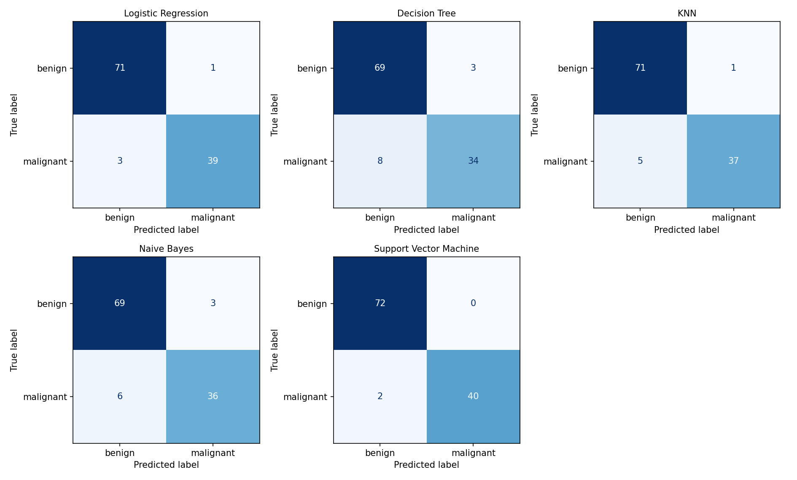

# Machine Learning Assignment 2 - Classification Models + Streamlit Deployment

**Programme:** M.Tech (AIML), BITS Pilani - Work Integrated Learning Programmes Division
**Course:** Machine Learning

## a. Problem Statement

Build and compare five classical classification models on one public dataset, evaluate each with six metrics (Accuracy, AUC, Precision, Recall, F1, MCC), and deploy an interactive Streamlit web application that loads the saved models and evaluates them on an uploaded test CSV without retraining.

The concrete task is **breast-cancer diagnosis**: given 30 numeric measurements of a cell nucleus from a fine-needle-aspirate image, predict whether the tumour is **malignant** or **benign**. This is a binary classification problem in which a missed malignant case (false negative) is the costlier error, so Recall and MCC are watched closely in addition to Accuracy.

## b. Dataset Description

| Item | Detail |
|---|---|
| Name | Breast Cancer Wisconsin (Diagnostic) |
| Source | UCI Machine Learning Repository (also mirrored on Kaggle) |
| Task | Binary classification |
| Instances | 569 (minimum required: 500) |
| Features | 30 numeric (minimum required: 12) |
| Target | `diagnosis` - benign (357) / malignant (212) |
| Positive class | malignant (encoded as 1; precision / recall / F1 are reported for it) |
| Missing values | None |

**Features.** Ten real-valued characteristics are computed for each cell nucleus - radius, texture, perimeter, area, smoothness, compactness, concavity, concave points, symmetry and fractal dimension. For each one the dataset stores the **mean**, the **standard error** and the **worst** (mean of the three largest values), giving 10 x 3 = 30 features.

**Split and preprocessing.** Stratified 80 / 20 train-test split with `random_state=42` (455 train / 114 test rows). Numeric features are median-imputed and standardised inside a scikit-learn `Pipeline`, so the saved model files accept raw feature values. Hyper-parameters of every model were tuned with 5-fold stratified `GridSearchCV` (scoring = ROC-AUC) on the **training** data only; the test rows were used just once for the final scores below. The held-out rows are saved as `test_data.csv`.

## c. GitHub Repository Link

https://github.com/ach03/ml-assignment-2.git

Repository layout:

```
project-folder/
|-- assignment2.ipynb       notebook: data, training, evaluation, saving models
|-- app.py                  Streamlit application
|-- metrics_utils.py        metric + target-encoding helpers shared by notebook and app
|-- requirements.txt
|-- README.md
|-- test_data.csv           held-out test split (features + target) for the app
|-- data/                   full dataset (csv)
|-- model/                  saved pipelines (.joblib) for all five classifiers + meta.json
`-- results/                metrics.csv, confusion_matrices.png
```

**Run locally**

```
pip install -r requirements.txt
jupyter notebook assignment2.ipynb      # run all cells to regenerate models
streamlit run app.py
```

## d. Models Used

All five models were trained on the same training split and evaluated on the same test set.

| ML Model Name | Accuracy | AUC | Precision | Recall | F1 | MCC |
|---|---|---|---|---|---|---|
| Logistic Regression | 0.9649 | 0.9960 | 0.9750 | 0.9286 | 0.9512 | 0.9245 |
| Decision Tree | 0.9035 | 0.9716 | 0.9189 | 0.8095 | 0.8608 | 0.7911 |
| KNN | 0.9474 | 0.9823 | 0.9737 | 0.8810 | 0.9250 | 0.8872 |
| Naive Bayes | 0.9211 | 0.9891 | 0.9231 | 0.8571 | 0.8889 | 0.8292 |
| Support Vector Machine | 0.9825 | 0.9960 | 1.0000 | 0.9524 | 0.9756 | 0.9626 |

Tuned hyper-parameters: Logistic Regression `C=1`; Decision Tree `max_depth=5, min_samples_leaf=5`; KNN `n_neighbors=11, weights=distance`; Naive Bayes `var_smoothing=1e-09`; Support Vector Machine `C=10, gamma=0.01`.

Confusion-matrix counts on the test set (positive = malignant):

| ML Model Name | TN | FP | FN | TP |
|---|---|---|---|---|
| Logistic Regression | 71 | 1 | 3 | 39 |
| Decision Tree | 69 | 3 | 8 | 34 |
| KNN | 71 | 1 | 5 | 37 |
| Naive Bayes | 69 | 3 | 6 | 36 |
| Support Vector Machine | 72 | 0 | 2 | 40 |



### Observations on model performance

| ML Model Name | Observation about model performance |
|---|---|
| Logistic Regression | Very strong baseline with the joint-highest AUC. After scaling, the two classes are close to linearly separable, so a straight-line boundary works well. It has very few false positives but misses a few malignant cases, so its recall is a little below the SVM. Fast, stable and easy to interpret. |
| Decision Tree | Weakest model: lowest accuracy, recall and MCC, and the most missed malignant cases. Axis-aligned splits are inefficient on strongly correlated size features (radius, perimeter, area), and a single tree is less stable than the other models. Its main advantage is interpretability. |
| KNN | Good and precise, with very few false positives, but it misses more malignant cases than Logistic Regression or SVM. Distance-based voting depends on feature scaling, which the pipeline provides, and the tuned k with distance weighting smooths out noise. Prediction is slower because it stores the whole training set. |
| Naive Bayes | Middle-of-the-pack accuracy but a high AUC, so it ranks cases well while losing recall at the default 0.5 cut-off. The independence assumption is violated because many features are strongly correlated. Extremely cheap to train. |
| Support Vector Machine | Best model on the threshold-based metrics: highest accuracy, precision, recall, F1 and MCC, with the fewest errors in the confusion matrix. The RBF kernel can bend the boundary beyond a straight line, and the large-margin objective on scaled inputs keeps it robust on this small, clean dataset. |
| **Overall winner for this dataset** | **Support Vector Machine (RBF).** It leads on Accuracy, Precision, Recall, F1 and MCC and ties Logistic Regression on AUC, and it makes the fewest costly errors (missed malignant cases). Logistic Regression is a close and more interpretable runner-up. The test set is small, so one or two samples move the metrics noticeably. |

## Streamlit Application

Live app: https://ml-assignment-2-8naxb5xha6hsj996fnecap.streamlit.app/

The app (`app.py`) loads the pre-trained pipelines from `model/` - **it never retrains** - and provides:

- **CSV upload** of the test data (must contain all feature columns and the `diagnosis` target column; a "use bundled sample" tick-box and a download button for `test_data.csv` are also provided)
- **Model selection dropdown** with the five classifiers (shows the tuned hyper-parameters of the chosen model)
- **Evaluation metrics** - Accuracy, AUC, Precision, Recall, F1 and MCC for the selected model
- **Confusion matrix and classification report** for the selected model
- Extras: ROC curve, a side-by-side comparison table of all five models on the uploaded data, row-level predictions with a download button, and input validation with clear error messages
